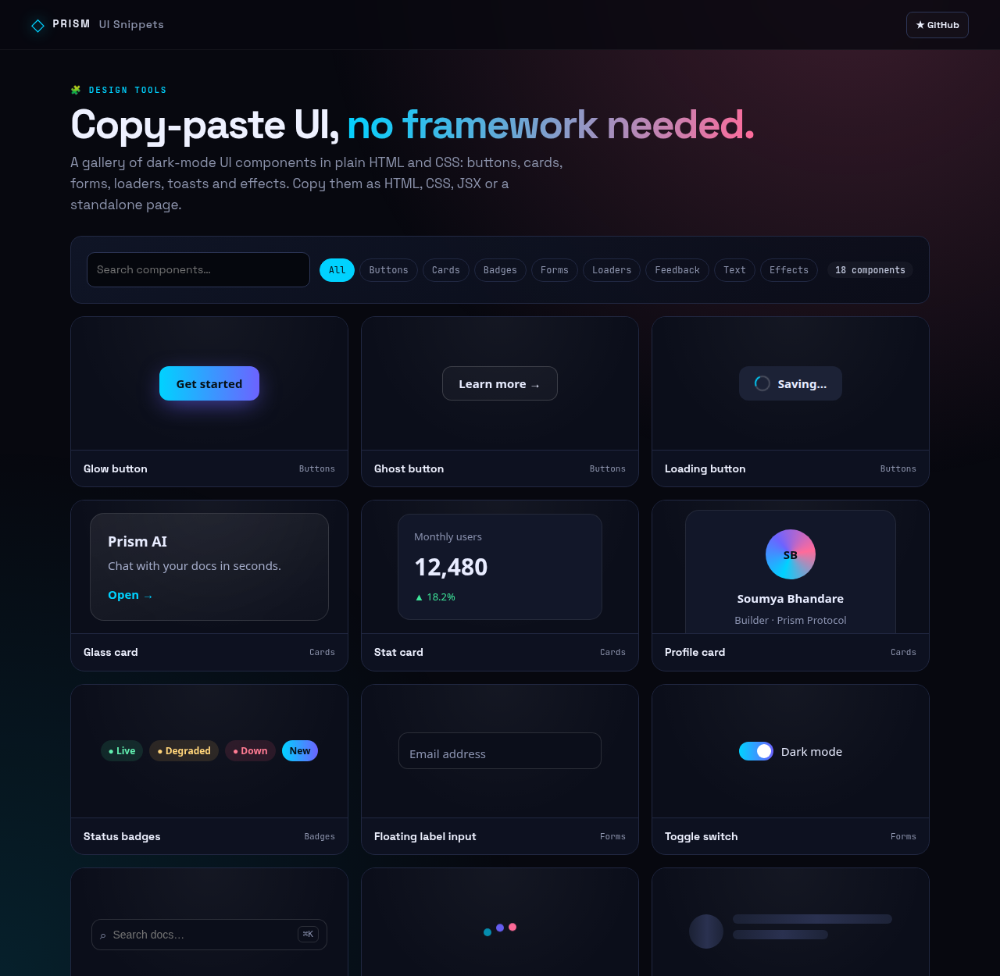
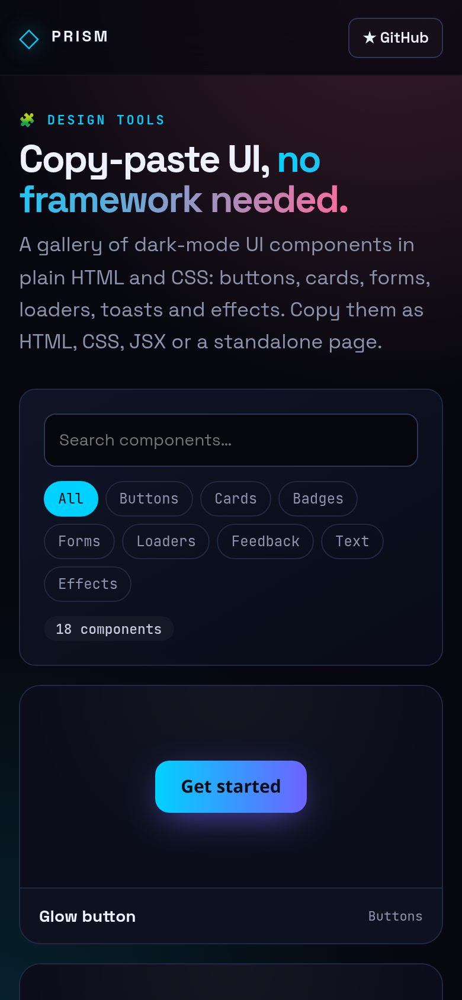

<!-- ═════════════ HEADER ═════════════ -->
<p align="center">
  
</p>

<p align="center">
  
</p>

<p align="center">
  <a href="https://github.com/krishyaa06/prism-ui-snippets/actions/workflows/ci.yml"></a>
  <a href="https://krishyaa06.github.io/prism-ui-snippets/"></a>
  
  
  <a href="LICENSE"></a>
</p>

<p align="center">
  
</p>


## ⚡ Overview

**Prism UI Snippets** is a gallery of small, polished UI pieces you can drop into any project, with no framework or build step. Each component is plain HTML and namespaced CSS (`pui-*` classes), previewed live in an isolated Shadow DOM so styles never clash. Open one to copy its HTML, formatted CSS, a React-ready JSX version or a standalone HTML page.

## ✨ Features

- **18 components** across buttons, cards, badges, forms, loaders, feedback, text and effects
- **Live previews** in Shadow DOM — no style leakage
- **Namespaced CSS** (`pui-` prefix) safe to paste anywhere
- **4 exports**: HTML, pretty CSS, JSX (`className`, style objects, `defaultChecked`), standalone page
- Search + category filter
- Tests ensure every class has CSS and braces balance

## 📸 Screenshots

<table>
  <tr>
    <td width="68%"></td>
    <td width="32%"></td>
  </tr>
</table>

## 🚀 Quick Start

**Use it online:** [https://krishyaa06.github.io/prism-ui-snippets/](https://krishyaa06.github.io/prism-ui-snippets/)

**Run locally:**

```bash
git clone https://github.com/krishyaa06/prism-ui-snippets.git
cd prism-ui-snippets
# open index.html in your browser, or serve it:
npx serve .
```

## 🛠️ Usage

Browse or search the gallery, click a component, choose **HTML / CSS / JSX / Standalone** and hit **Copy**.

Add your own by appending to the `COMPONENTS` array in `js/core.js`.

## 📁 Project Structure

```
prism-ui-snippets/
├── assets/
│   ├── logo.png
│   └── logo.svg
├── css/
│   ├── app.css
│   └── prism.css
├── js/
│   ├── app.js   # gallery + dialog
│   ├── core.js   # component registry + exporters — tested in Node
│   └── prism.js
├── test/
│   └── core.test.js
├── .gitignore
├── LICENSE
├── index.html
└── package.json
```

## 🧪 Tests

```bash
npm test
```

Tests use the built-in `node:test` runner, so there is nothing to install. CI runs them on Node 20 and 22.

## 🤝 Contributing

1. Fork the repo and create a branch: `git checkout -b feature/my-idea`
2. Make your change and add a test in `test/`
3. Run `npm test` and open a Pull Request

## 🔷 Part of Prism Protocol

Prism UI Snippets is one of the open-source tools built by [Prism Protocol](https://dc.gg/prismprotocol), a tech community where young builders learn, ship and compete together.

## 👤 Author

<table>
  <tr>
    <td align="center">
      <a href="https://github.com/krishyaa06"><br><b>Soumya Bhandare</b></a><br>
      <sub>Founder @ Prism Protocol</sub>
    </td>
    <td>
      <a href="https://dc.gg/prismprotocol"></a><br>
      <a href="https://instagram.com/prism_protocol_"></a><br>
      <a href="https://x.com/krishyaa06"></a>
    </td>
  </tr>
</table>

## 📄 License

Released under the [MIT License](LICENSE).

<p align="center">
  <b>If you like this project, consider giving it a ⭐</b><br>
  <sub>"Build. Create. Compete." · Made with ⚡ by Prism Protocol</sub>
</p>


